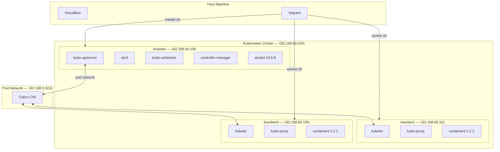
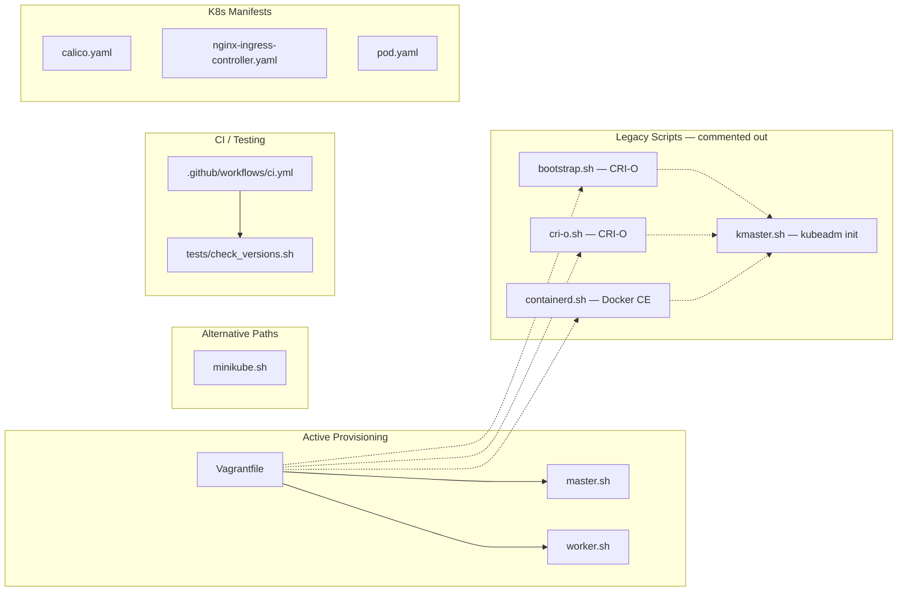
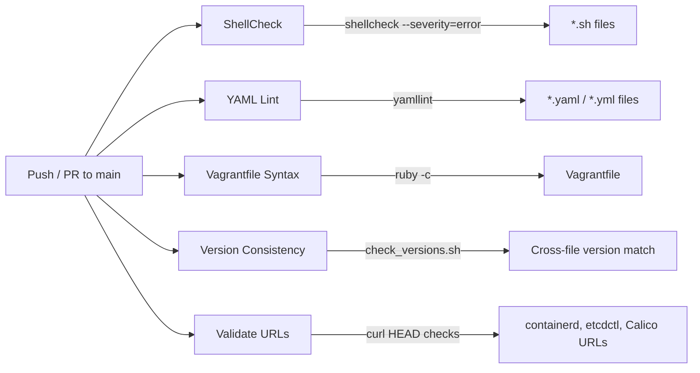

# CKA Prep - Kubernetes Cluster Lab Environment

A fully automated multi-node Kubernetes cluster provisioned with Vagrant and VirtualBox, designed for **Certified Kubernetes Administrator (CKA)** exam preparation.

## Architecture

### Cluster Topology



### Provisioning Flow

```mermaid
flowchart LR
    A["vagrant up"] --> B["Vagrantfile"]
    B -->|"kmaster VM"| C["master.sh"]
    B -->|"kworkerN VMs"| D["worker.sh"]

    C --> C1["Hosts & Terminal"]
    C1 --> C2["Disable Swap"]
    C2 --> C3["Install K8s 1.35.2"]
    C3 --> C4["containerd 2.2.2"]
    C4 --> C5["Kernel Modules & Sysctl"]
    C5 --> C6["kubeadm init"]
    C6 --> C7["Deploy Calico CNI"]
    C7 --> C8["Install etcdctl v3.6.8"]
    C8 --> C9["Generate Join Command"]

    D --> D1["Hosts & Terminal"]
    D1 --> D2["Disable Swap"]
    D2 --> D3["Install K8s 1.35.2"]
    D3 --> D4["containerd 2.2.2"]
    D4 --> D5["Kernel Modules & Sysctl"]
    D5 --> D6["kubeadm reset"]
    D6 --> D7["Ready for Join"]

    C9 -.->|"manual join"| D7
```



### File Structure



## Component Versions

| Component | Version | Files |
|-----------|---------|-------|
| Ubuntu | 22.04 LTS (jammy64) | `Vagrantfile` |
| Kubernetes | 1.35.2 | `master.sh`, `worker.sh`, `minikube.sh` |
| containerd | 2.2.2 | `master.sh`, `worker.sh` |
| etcdctl | v3.6.8 | `master.sh` |
| CRI-O | 1.35 | `bootstrap.sh`, `cri-o.sh` |
| Calico CNI | v3.31.4 | `kmaster.sh` |
| Alpine (practice pod) | 3.21.6 | `pod.yaml` |

## Network Layout

| Subnet | Purpose |
|--------|---------|
| `192.168.60.0/24` | Node network (host-only) |
| `192.168.0.0/16` | Pod network CIDR (Calico) |

| Node | Hostname | IP |
|------|----------|----|
| Master | `kmaster.example.com` | `192.168.60.100` |
| Worker 1 | `kworker1.example.com` | `192.168.60.101` |
| Worker N | `kworkerN.example.com` | `192.168.60.10N` |

## Prerequisites

- [Vagrant](https://www.vagrantup.com/docs/installation) >= 2.3
- [VirtualBox](https://www.virtualbox.org/wiki/Downloads) >= 7.0
- Minimum 4 GB free RAM (2 GB master + 1 GB per worker)
- Minimum 2 CPU cores available

## Quick Start

```sh
# Clone the repository
git clone https://github.com/ausard/CKA-Prep.git
cd CKA-Prep

# Start the cluster (provisions master + 1 worker)
vagrant up

# SSH into the master node
vagrant ssh kmaster

# Verify the cluster
kubectl get nodes
```

### Joining Worker Nodes

After provisioning, worker nodes need to be manually joined to the cluster:

```sh
# On the master node — generate the join command
kubeadm token create --print-join-command --ttl 0

# On the worker node — paste and run the output from above
sudo kubeadm join 192.168.60.100:6443 --token <token> --discovery-token-ca-cert-hash sha256:<hash>
```

### Minikube Alternative

For a lighter-weight setup without Vagrant/VirtualBox VMs:

```sh
# Start a 2-node Minikube cluster with ingress
bash minikube.sh
```

## Cluster Configuration

### Scaling Worker Nodes

Edit `NodeCount` in the `Vagrantfile` to add more workers:

```ruby
NodeCount = 2  # Creates kworker1 and kworker2
```

Each additional worker gets:
- 1024 MB RAM, 1 CPU
- IP `192.168.60.10N` (where N is the worker number)

### VM Resources

| Node | RAM | CPUs |
|------|-----|------|
| kmaster | 2048 MB | 2 |
| kworkerN | 1024 MB | 1 |

## Project Files

### Active Provisioning (used by `vagrant up`)

| File | Purpose |
|------|---------|
| `Vagrantfile` | VM topology — defines master + N workers on VirtualBox |
| `master.sh` | Control plane provisioning — K8s packages, containerd, kubeadm init, Calico CNI, etcdctl |
| `worker.sh` | Worker node provisioning — K8s packages, containerd, ready for kubeadm join |

### Alternative / Legacy Scripts (commented out in Vagrantfile)

| File | Runtime | Purpose |
|------|---------|---------|
| `bootstrap.sh` | CRI-O | Base provisioner for all nodes (uses `192.168.56.x` subnet) |
| `cri-o.sh` | CRI-O | Base provisioner for all nodes (uses `192.168.60.x` subnet) |
| `containerd.sh` | Docker CE + containerd | Base provisioner with Docker CE |
| `kmaster.sh` | — | Lightweight kubeadm init + Calico (pairs with bootstrap/cri-o/containerd scripts) |
| `minikube.sh` | — | Standalone 2-node Minikube cluster with ingress |

### Kubernetes Manifests

| File | Purpose |
|------|---------|
| `pod.yaml` | Practice pod — Alpine container writing random hashes to an emptyDir volume with `readOnlyRootFilesystem: true` |
| `calico.yaml` | Calico CNI manifest |
| `nginx-ingress-controller.yaml` | NGINX Ingress Controller manifest |

### CI / Testing

| File | Purpose |
|------|---------|
| `.github/workflows/ci.yml` | GitHub Actions pipeline — ShellCheck, yamllint, Ruby syntax, version consistency, URL validation |
| `tests/check_versions.sh` | Verifies Kubernetes/containerd versions match across all scripts and validates semver format |

## CI Pipeline

The CI workflow runs on every push and pull request to `main` with 5 parallel jobs:



| Job | Tool | Checks |
|-----|------|--------|
| `shellcheck` | ShellCheck | Lint all `.sh` scripts for errors |
| `yaml-lint` | yamllint | Validate YAML syntax and formatting |
| `vagrantfile-syntax` | `ruby -c` | Ruby syntax validation |
| `version-consistency` | `check_versions.sh` | K8s, containerd versions match across files; semver format; file existence |
| `validate-urls` | curl | Download URLs for containerd, etcdctl, and Calico are reachable |

## What master.sh Provisions

The primary provisioning script (`master.sh`) performs these steps on the control-plane node:

1. **Host entries** — populates `/etc/hosts` for cluster DNS
2. **Terminal setup** — bash-completion, vim config, kubectl aliases (`k=kubectl`)
3. **Disable swap** — required by kubelet
4. **Clean slate** — `kubeadm reset` + removes existing packages
5. **Podman** — installs podman and cri-tools from Kubic repo
6. **Kubernetes packages** — kubelet, kubeadm, kubectl `1.35.2-00` pinned with `apt-mark hold`
7. **containerd upgrade** — replaces apt containerd with `2.2.2` from GitHub releases
8. **Kernel modules** — loads `overlay` and `br_netfilter`
9. **Sysctl** — enables bridge netfilter and IP forwarding
10. **containerd config** — `SystemdCgroup = true`, `io.containerd.runc.v2` runtime
11. **kubeadm init** — initializes the cluster on `192.168.60.100` with pod CIDR `192.168.0.0/16`
12. **Calico CNI** — deploys the pod network
13. **etcdctl** — installs `v3.6.8` for etcd inspection practice
14. **Join command** — prints the `kubeadm join` command for workers

## License

This project is for educational and CKA exam preparation purposes.
